<p align="center">
  <picture>
    <source media="(prefers-color-scheme: dark)" srcset="app/brand/wirebond-logo.svg">
    
  </picture>
</p>

<p align="center"><b>A viewable wire bond exchange format, and a browser app that lays out wire bonds for KiCad.</b></p>

<h3 align="center">
  <a href="https://anfroholic.github.io/wirebonding.svg/app/">▶&nbsp;Open Wire Bond Bench</a>
</h3>

<p align="center">Runs in your browser. Nothing to install, and your files stay on your computer.</p>

<p align="center">
  <a href="https://anfroholic.github.io/wirebonding.svg/examples/example.wb.svg">See an example .wb.svg</a> ·
  <a href="https://anfroholic.github.io/wirebonding.svg/docs/primer/wire-bonding-primer.html">Wire bonding primer</a> ·
  <a href="SPEC.md">Spec</a> ·
  <a href="examples">Examples</a> ·
  <a href="tools">Tools</a>
</p>

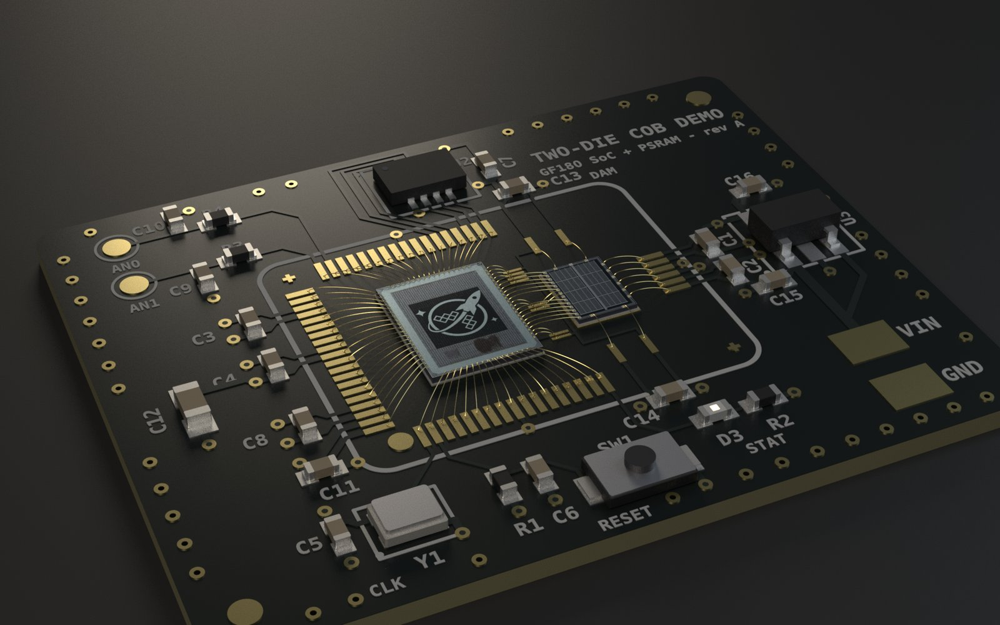

wirebond.svg is a restricted SVG profile for describing a wire bonded assembly. A `.wb.svg` file opens in any browser as a true-scale bonding diagram, and tools read the same file as data.


<table>
  <tr>
    <td width="50%">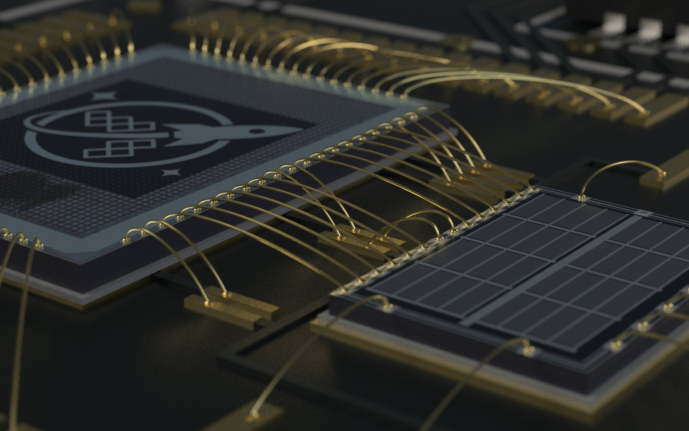</td>
    <td width="50%">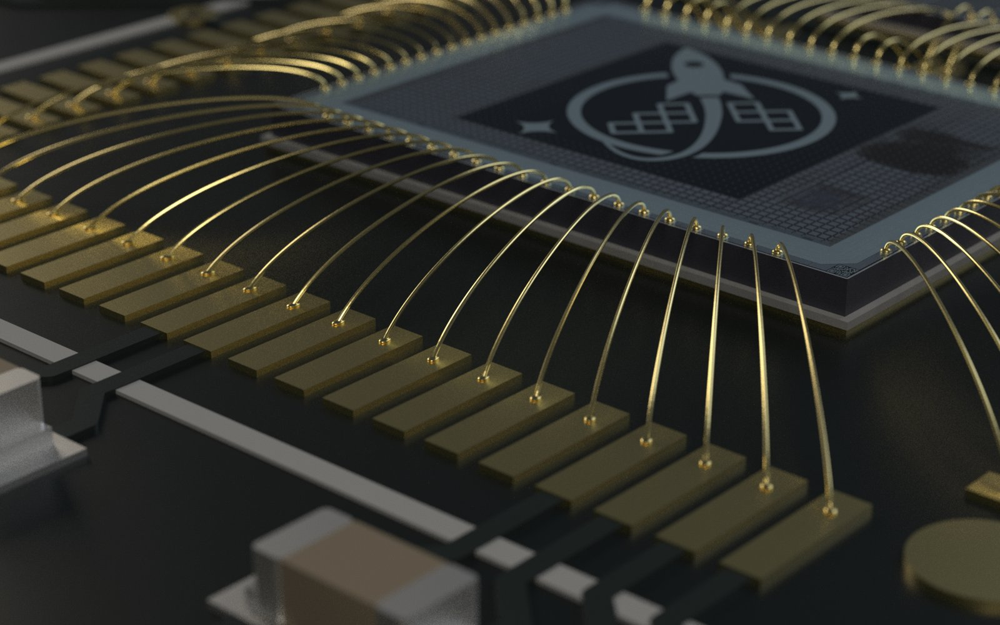</td>
  </tr>
  <tr>
    <td>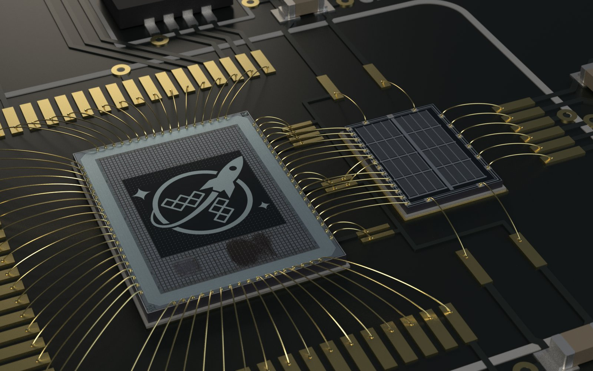</td>
    <td>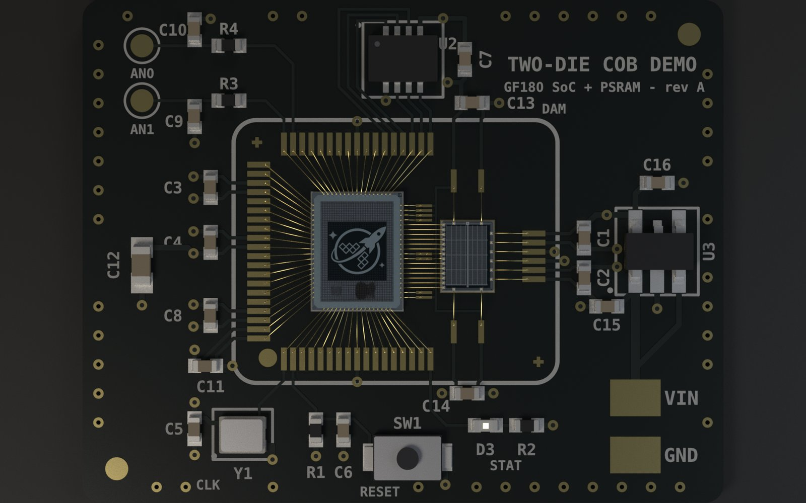</td>
  </tr>
</table>

## Why a picture

Wire bonding already runs on pictures. A bonding diagram is the accepted exchange format today, and everything around it is built for people reading drawings. With AI reading more of our files, I think formats should become more human-centric anyway, not less.

So keep the picture. Save it as an SVG, which is just XML under the hood, and put the wire bond data right into that XML as key/value pairs on the drawn elements.

> Humans get what they want.
>
> Machines can read what they want.

## Wire Bond Bench

Wire Bond Bench is the browser app that goes with the format: wire bond layout for KiCad. Give it a die's GDS and the footprint or board it bonds to. It lays out the wires, checks them against bonding design rules, and writes the assembly back to KiCad with 3D wires, a bondlist and a `.wb.svg` bond diagram.

**[Open it in your browser](https://anfroholic.github.io/wirebonding.svg/app/)**, in Chrome or Edge. There's nothing to install, and your files stay in the browser. To run it from a copy of this repo instead, open [app/index.html](app/index.html). A few features run the Python in [tools/](tools), such as checking the die at the edges of its placement tolerance. The browser downloads Python for those the first time one is used, so that needs a connection.

The app opens each of the boards below from its welcome screen. Each picture is the board as the app exports it to KiCad, with the die's artwork painted on from its GDS and every wire in 3D, rendered in Blender.

<table>
  <tr>
    <td colspan="2">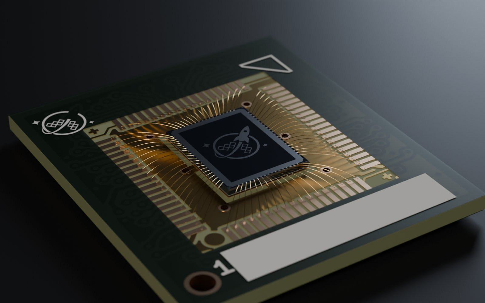</td>
  </tr>
  <tr>
    <td width="50%">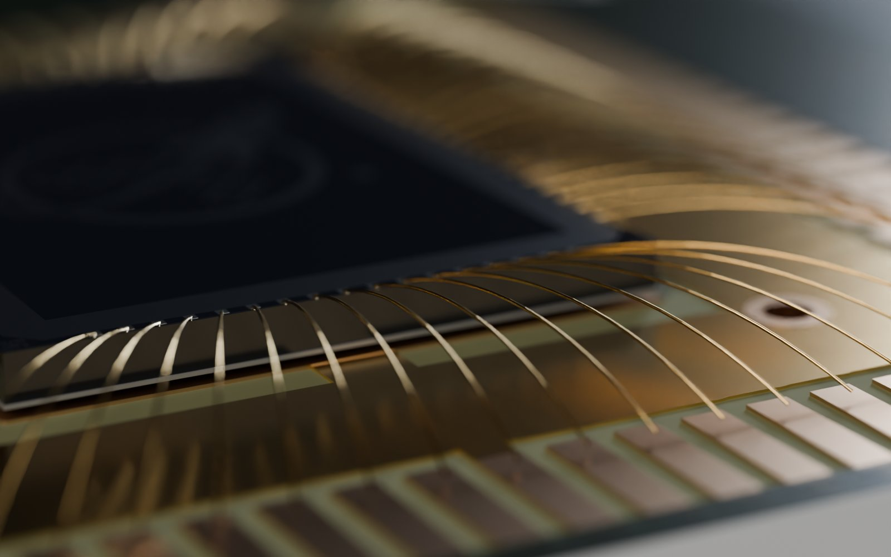</td>
    <td width="50%">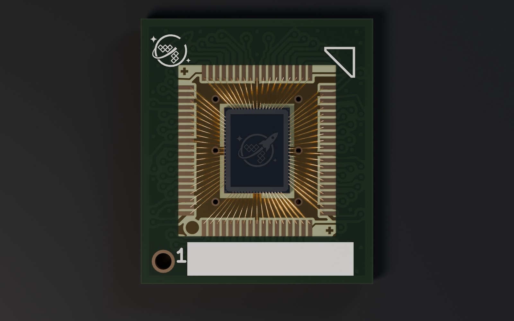</td>
  </tr>
  <tr>
    <td colspan="2"><b>wafer.space die on a real COB board.</b> The logo die on wafer.space's run-2 1x1 <a href="https://github.com/wafer-space/chip-on-board-wire-bonded-pcbs">chip-on-board mezzanine</a>, 74 wires, one per pad.</td>
  </tr>
</table>

| | |
|---|---|
| 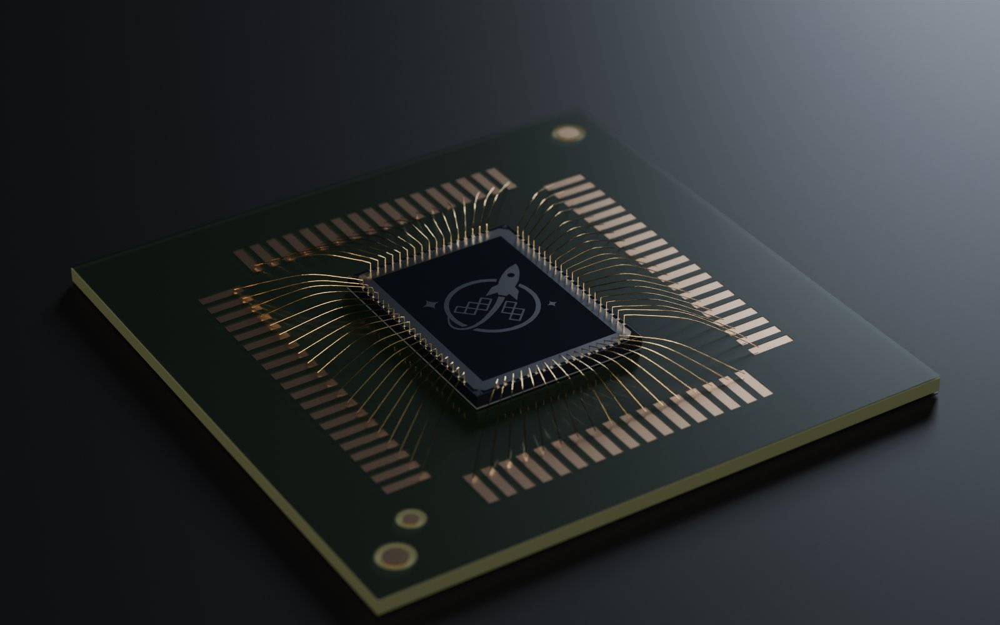 | 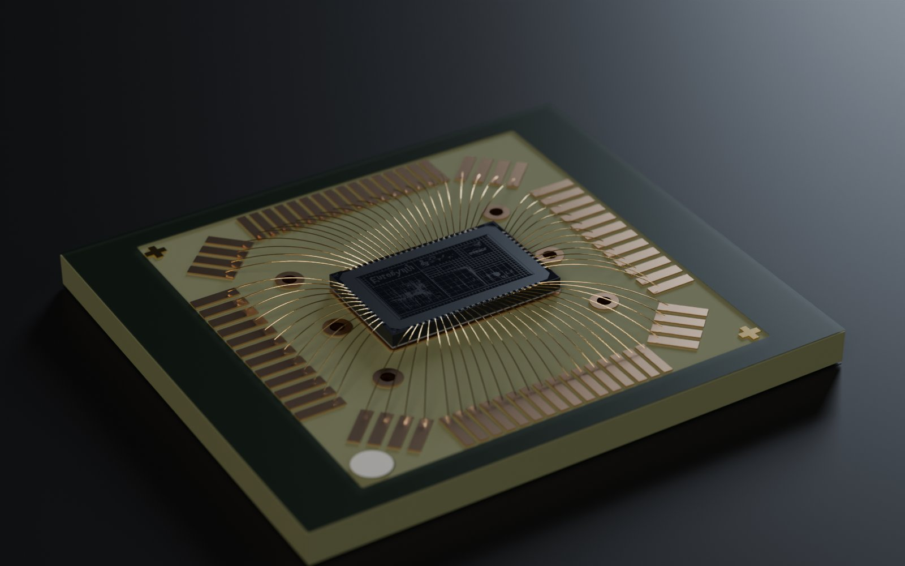 |
| **The main example.** The logo die on its padring alone: the board in [examples/kicad](examples/kicad), and [examples/example.wb.svg](examples/example.wb.svg). | **EuroSynth.** A synth chip in the 1x0p5 slot, 72 pads, on its padring. |
| 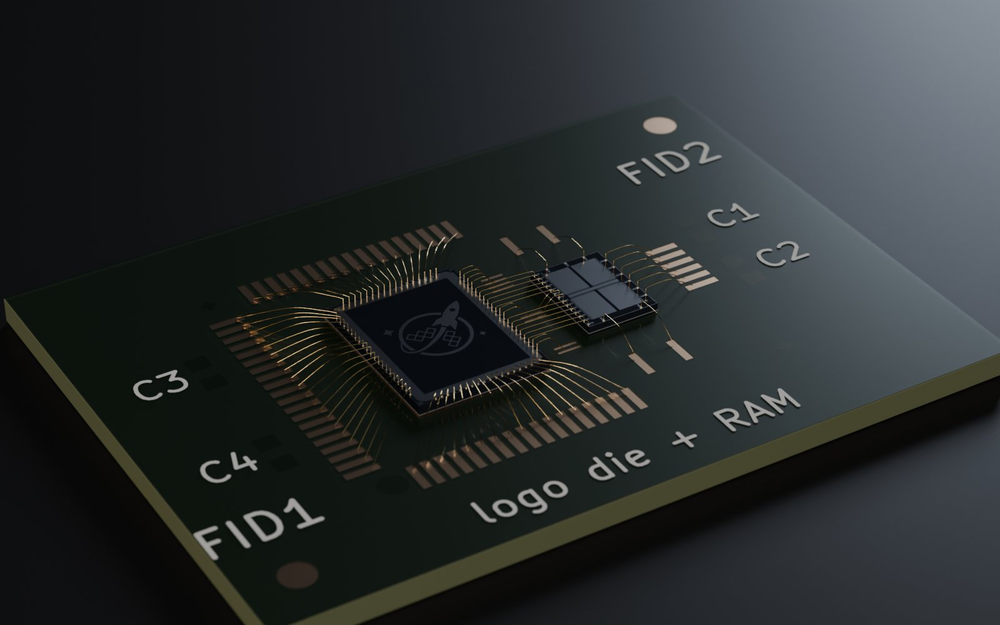 | 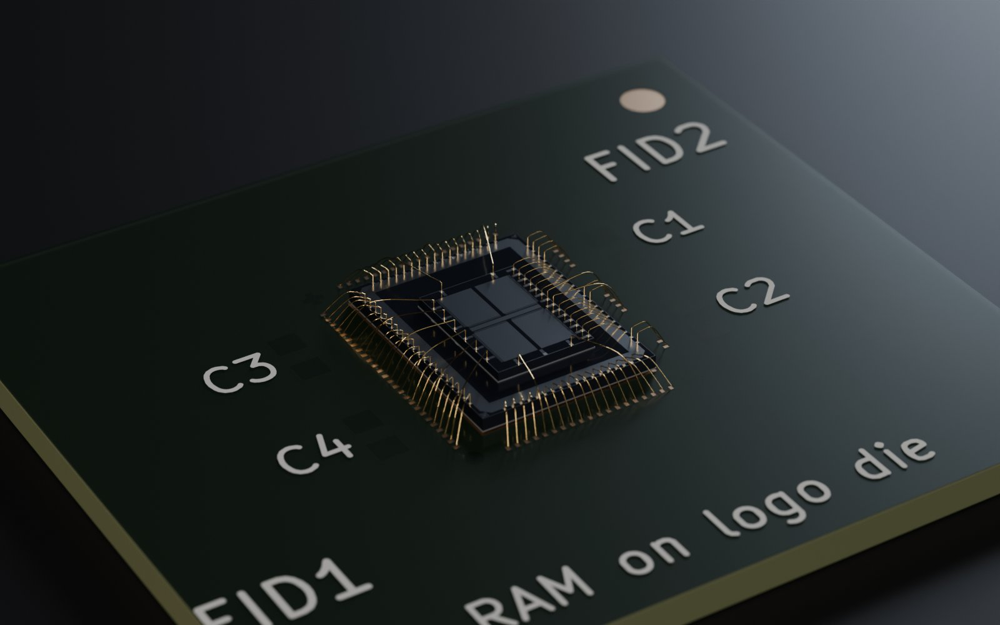 |
| **Two die.** The logo die beside a made-up RAM die, wired straight across: [examples/two_die](examples/two_die). | **Stacked die.** The RAM die glued on top of the logo die: [examples/stacked_die](examples/stacked_die). |
|  | 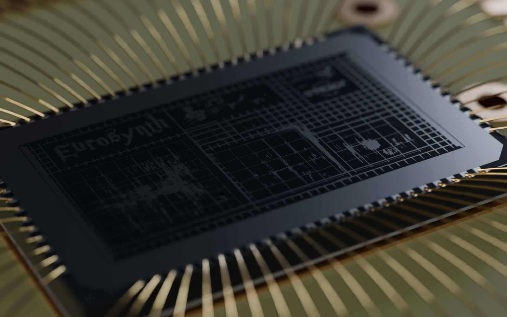 |

## The format

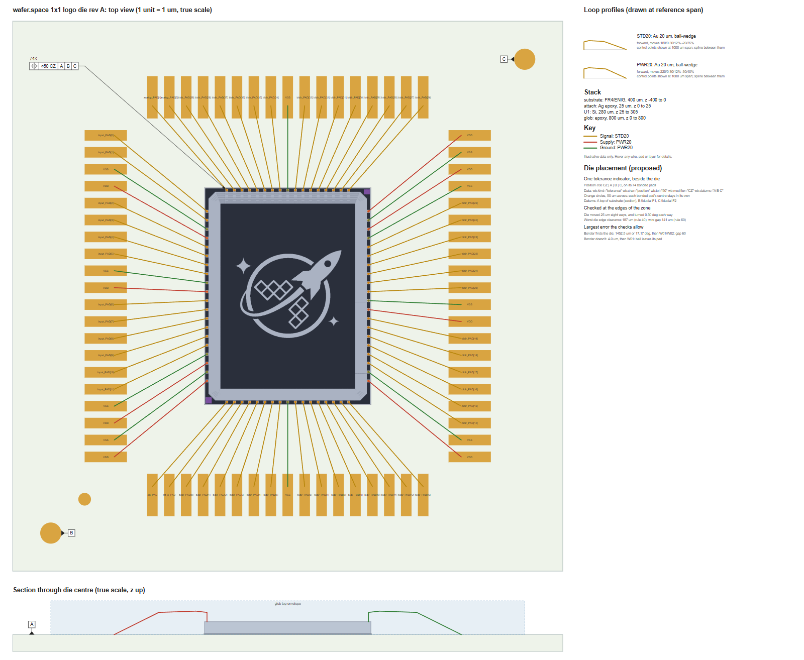

That picture is [examples/example.wb.svg](examples/example.wb.svg), opened in a browser. It is also the data:

- The picture is the data: 1 SVG unit = 1 µm, `stroke-width` is wire diameter, `rect` is a pad opening.
- Height lives in a drawn section view, where a rectangle's height is that layer's thickness.
- Everything else sits on drawn elements as `wb:` attributes.
- Loop shapes are parametric, so one profile fits any wire span.
- Wires reference pads by name, and a checker catches geometry that has drifted.
- The die's artwork is a picture drawn over its outline. It's decoration, and nothing reads data from it.

### What's inside

This is [examples/example.wb.svg](examples/example.wb.svg), cut down to one of each thing. The `<!-- -->` notes are added, and the hover titles, Inkscape layer names and most of the drawing are left out, but the values are the file's own.

```xml
<svg xmlns="http://www.w3.org/2000/svg" xmlns:wb="urn:wbx:0.1" viewBox="-300 -500 19000 15600"
     wb:version="0.1" wb:units="um" wb:design="wafer.space 1x1 logo die" wb:rev="A"
     wb:rule-wire-gap="60" wb:rule-edge-clear="40">

  <!-- The board: an outline, and a land per bond finger. 1 unit = 1 µm, so this land is 250 × 1000 µm. -->
  <g>
    <rect x="0" y="0" width="13000" height="13000" class="sub" wb:kind="outline" wb:name="SUB"/>
    <rect x="3175" y="10700" width="250" height="1000" class="cu"
          wb:kind="land" wb:name="L1" wb:net="clk_PAD" wb:finish="ENIG"/>
    <circle cx="900" cy="12100" r="250" class="cu" wb:kind="fiducial" wb:name="F1" wb:role="align" wb:datum="B"/>
  </g>

  <!-- The die, placed by its transform. Inside it, coordinates are the die's own, y up as in its GDS. -->
  <g transform="translate(4534 9061) scale(1 -1)" wb:kind="die" wb:name="U1" wb:gds-cell="chip_top" wb:pad-layer="37/0">
    <rect x="0" y="0" width="3932" height="5122" class="die" wb:kind="outline"/>
    <g transform="scale(1 -1)"><title>U1 artwork</title>
      <image x="0" y="-5122" width="3932" height="5122" href="data:image/png;base64,iVBORw0KGgo…"/>
    </g>
    <rect x="496" y="28" width="60" height="60" class="pad" wb:kind="pad" wb:name="1" wb:net="clk_PAD"/>
  </g>

  <!-- A wire from die pad U1.1 to land L1. stroke-width is the wire's diameter: 20 µm. -->
  <line x1="5060" y1="9003" x2="3300" y2="11000" stroke-width="20" class="w sig"
        wb:kind="wire" wb:name="W01" wb:from="U1.1" wb:to="L1" wb:profile="STD20"
        wb:seq="1" wb:tier="1" wb:net="clk_PAD"/>

  <!-- How the wire loops: a parametric profile that fits any span, drawn beside the plan. -->
  <g wb:kind="profile" wb:name="STD20" wb:material="Au" wb:style="ball-wedge" wb:dir="forward"
     wb:moves="180/0 30/12% -20/35%" wb:interp="spline" wb:ref-span="1000">…</g>

  <!-- Heights: the section view. Each rectangle's height is that layer's thickness: a 280 µm die. -->
  <rect x="4534" y="-305" width="3932" height="280" wb:kind="layer" wb:name="U1" wb:role="die" wb:material="Si"/>

  <!-- Where the die may land: a position tolerance to datums A, B and C. -->
  <g wb:kind="tolerance" wb:applies-to="U1" wb:char="position" wb:tol="50" wb:modifier="CZ" wb:datums="A B C">…</g>
</svg>
```

A reader looks only at elements with a `wb:kind`, and takes their position and size from the drawing itself. Everything else, like the labels, the key and the artwork, is there for people. So the file a browser draws and the file a tool reads can't disagree.

[SPEC.md](SPEC.md) is the format. [docs/report.md](docs/report.md) has the design reasoning and a survey of prior art.

The code still uses the project's earlier name, WBX: `wbx.py` and the namespace `urn:wbx:0.1`.

## Examples

Open any `.wb.svg` in [examples/](examples) in a browser and hover over a wire, pad or layer.

| Example | What it is |
|---|---|
| [example.wb.svg](examples/example.wb.svg) | The wafer.space logo die, [89Mods/ws-logo-die](https://github.com/89Mods/ws-logo-die), bonded to the padring of wafer.space's run-2 1x1 [chip-on-board board](https://github.com/wafer-space/chip-on-board-wire-bonded-pcbs). Its pads, net names, eye points and artwork come from the die's GDS, and its lands from the padring footprint. The wire types, stack, board fiducials and tolerance are illustrative. Beside it are the bondlist, fiducials and 3D DXF that `wbx.py export` writes from it |
| [waferspace/](examples/waferspace) | The sources: the logo die and EuroSynth as GDS, their padrings, and the run-2 1x1 COB mezzanine board as a KiCad project |
| [two_die/](examples/two_die) | The logo die beside a made-up RAM die on one board, with wires straight across from die to die |
| [stacked_die/](examples/stacked_die) | The RAM die, turned round, glued on top of the logo die |
| [kicad/](examples/kicad) | The first example as a KiCad board |

## Tools

[tools/](tools) holds Python scripts for `.wb.svg` files. Each is one file you can copy out and run on its own, or import from your own code. [tools/README.md](tools/README.md) says how.

```sh
pip install lxml ezdxf
python tools/wbx.py check examples/example.wb.svg
python tools/wbx.py place examples/example.wb.svg     # how far the die can move before a check fails
python tools/wbx.py export examples/example.wb.svg out
```

`wbx.py` reads one die, not turned. The two-die and stacked examples are for the app until it reads more.

## Learning

New to wire bonding? These are web pages:

- [The wire bonding primer](https://anfroholic.github.io/wirebonding.svg/docs/primer/wire-bonding-primer.html): what bonding is, the words for it, and why each design rule is what it is. The rules are also drawn on [one sheet](https://anfroholic.github.io/wirebonding.svg/docs/wire_bond_design_rules.svg).
- [Fiducials](https://anfroholic.github.io/wirebonding.svg/docs/primer/fiducials.html): how pick and place machines and wire bonders find the board and the die, and how wirebond.svg describes fiducials.
- [Files in and out](https://anfroholic.github.io/wirebonding.svg/docs/primer/files-in-and-out.html): every file the app and `wbx.py` read and write, and what round-trips.
- [GD&T](https://anfroholic.github.io/wirebonding.svg/docs/primer/gdt.html): the tolerance box beside the die, and the die placement tolerance.

## Handling files

Do not run `.wb.svg` files through SVGO or other minifiers. They convert shapes to paths and remove `id` values, which breaks parsing. Editing in Inkscape, Illustrator or Figma is untested.

## Related work

[open.cob.json](https://github.com/MaxClerkwell/open.cob.json) is a JSON exchange format for chip-on-board wire bonding.

## Feedback

Feedback, ideas and issues are all welcome. [Open an issue](https://github.com/anfroholic/wirebonding.svg/issues).

## License

MIT, in [LICENSE](LICENSE). The wafer.space die and board files in [examples/waferspace](examples/waferspace) are Apache-2.0, from the sources in its [SOURCES.md](examples/waferspace/SOURCES.md).

<p align="center"></p>
