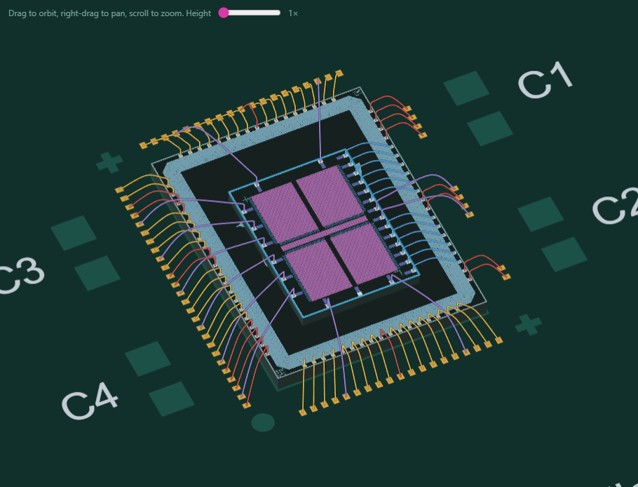

# Stacked die: a RAM die on top of the logo die

The RAM die from [`../two_die`](../two_die), turned round and glued on top of the wafer.space logo die. Twelve wires step down from the RAM to the logo die's pads, and the RAM's twelve supply wires reach over the logo die to lands on the board. It shows what a stack looks like, and how a board's lands are laid out for one.



To see it, open the Wire Bond Bench (`app/index.html`) and choose **RAM die stacked on the wafer.space die** under Examples. Or open [`stacked_die.wb.svg`](stacked_die.wb.svg) in a browser and hover any wire, pad or land.

**What's made up:** the RAM die and its pin order (the same as the two-die example's), the board, the wire types, the die thicknesses and the attach. The logo die is the real one from [`../waferspace`](../waferspace). Nothing here has been bonded.

## The parts

| | |
|---|---|
| D1, the logo die | 3.93 × 5.12 mm, 74 pads, 280 µm thick, on 25 µm of die attach: its top is 305 µm above the board |
| D2, the RAM die | The two-die example's `psram_die.gds`: 2.2 × 3.0 mm, 25 pads of 70 µm, 200 µm thick. Turned 180° and centred left to right on D1, on 25 µm of attach: its underside is at 330 µm and its top at 530 µm. It covers D1's logo, but none of D1's pads: the nearest bonded pad is 792 µm from its edge |
| The board | 18 × 16 × 0.8 mm. One footprint, J1, holds a single row of 74 lands round D1, the RAM's slotted in among D1's, and a VSS paddle under D1. Also two global fiducials and four 100 nF decoupling capacitors. No tracks |

## Where every wire goes

| From | To | Wires | Type |
|---|---|---|---|
| D1, every pad but the twelve bus pads | Its own land in the row, numbered as the pad | 62 | STD20, PWR20 |
| The RAM's VDD and VSS pads, all twelve | Lands 101 to 112, in the same row, between D1's | 12 | STK23 |
| The RAM's bus pads | D1's bidir pads 20 to 25 and 28 to 33, straight across | 12 | STEP20 |
| The RAM's TEST pad | Nothing: a probe pad for wafer test | 0 | |

86 wires in all. The bus is the two-die example's, with D1's pads on the same nets. Turning the RAM reverses which end is which: D1's pad 33 at the top now takes DQ0, and pad 20 at the bottom DQ7.

| D1 pad | D1 net | RAM pin |
|---|---|---|
| 20 to 23 | bidir_PAD[14] to [17] | DQ7 to DQ4 |
| 24 | bidir_PAD[18] | RESET_N |
| 25 | bidir_PAD[19] | CS_N |
| 26, 27 | VDD, VSS | none: the RAM's VSS and VDD face them, each going on to its own land |
| 28 | bidir_PAD[20] | CK |
| 29 | bidir_PAD[21] | RWDS |
| 30 to 33 | bidir_PAD[22] to [25] | DQ3 to DQ0 |

## Why it's laid out this way

**The RAM is turned 180°.** Its bus is on one long edge, and D1's bidirectional pads are on its right edge. Turned, the RAM's bus edge faces right, and each bus pad sits level with one of D1's, as in the two-die example. So the twelve bus wires run straight and parallel, 868 µm each. A turned die is ordinary in a stack: you can't change a bought die's pads, only how you place it.

**Ball on the RAM, stitch on the logo die.** The RAM is the higher die, so the wire starts there and steps down 225 µm to D1, as a wire to the board steps down from its die. Its stitch lands on an active die pad, so bonders put a stud bump on each of D1's twelve bus pads first and stitch onto that: bond stitch on ball (BSOB), as on the RAM's pads in the two-die example. Those wires are bonded last. Each comes to its pad from over D1, from the inside, which the bench's angle check now allows for (see below).

**One row of lands, close in.** The 1x1 padring's lands are 1.8 mm from the die, which is fine for one die. Here every land's inner end is 565 µm from D1: the die-edge-to-land rule asks for twice the die's 280 µm thickness, because die attach bleeds out from under it. D1's wires are short, 688 to 939 µm, so none passes the 100-diameter rule of thumb, against 44 on the padring. The lands are 100 µm wide and 130 µm long, at a pitch of 205 µm or more, which leaves 105 µm of board between them for the 0.1 mm clearance. D1's pads are 180 µm apart on its short edges and 211 µm on its long ones, so its lands fan out a little: the outermost wire leaves its pad at 43°, under the 45° limit.

**The RAM's supply wires reach over to the same row.** Each goes in a straight line from its pad, over D1's surface, through a gap between two of D1's pads, and onto a land of its own between two of D1's lands. In plan it never crosses another wire. It passes at least 80 µm from the pads either side of its gap, and no two wires come closer than 73 µm, over the 60 µm rule. `make_stacked_die.py` searches for the layout: for each RAM wire it tries the nearest gaps and land positions 5 µm apart, and fits D1's lands round them as straight as the pitch allows.

**Those wires are 23 µm, not 20.** They span 1.56 to 2.14 mm, the longest on the board. At 20 µm the longest would be 107 wire diameters; at 23 µm it's 93, under the rule of thumb for sag and sweep. The RAM's 70 µm pads still take a 23 µm wire, at three diameters. D1's 60 µm pads wouldn't, and D1 has no 23 µm wire.

**Their loop stays high, then comes down late.** STK23 rises 200 µm from the RAM's top to 730 µm, stays near there over D1's edge and over the balls and loops of D1's own wires, and comes down over the last 30% of its span. The bench's die edge check, which follows each wire over every die it passes, finds no wire closer than 137 µm to an edge. The highest loop on the board is 750 µm.

**The lower die is bonded first.** Its wires are the lowest. The RAM's wires to the board come next, higher, passing between them, and the RAM's wires down to D1 go last, after their stud bumps.

**The supply pair in the middle of the bus.** In the two-die example, D1's VDD and VSS pads 26 and 27 shared two lands with the RAM's VDD and VSS opposite them. Turned, the RAM's pair is the wrong way round: its VSS faces D1's VDD, and its VDD faces D1's VSS. So nothing is shared. D1's pads 26 and 27 go straight out to their lands, and the RAM's pair angle away from them by 7.5°, out through the gaps on either side, to lands 103 and 104.

## What the format and tools can't say yet

- **Nets across two die.** As in the two-die example, each die names its pads for itself, so the twelve bus wires warn: `bidir_PAD[14]` at one end and `DQ7` at the other.
- **The stud bumps.** Nothing in the file says D1's bus pads get a bump before their stitch. SPEC.md lists `security-bump` as proposed.
- **`drc.py` reads one die,** and not a turned one, so `drc.py check` can't check this file. The bench's checks cover both die.
- **Loop heights in the wire gap check.** Nothing crosses here, so it doesn't matter, but the bench's 60 µm wire-to-wire gap is measured in plan. A stack that let the RAM's wires cross over D1's, as multi-tier packages do, would warn on every crossing even where the loops are far apart. Its crossing check between different die does compare heights.

The bench's checks on it: nothing fails, nothing crosses, and only the twelve net warnings aren't a pass. It also notes that the RAM's twelve wires to the board run over another die, and that the RAM's TEST pad isn't bonded. KiCad's DRC of the board, and of the assembled board the bench writes, finds nothing but the unrouted nets.

## Two changes to the bench this example needed

- **The angle check, on a lower die.** It measured every wire against the direction straight out from the pad's die edge. A wire coming down from a die stacked above reaches the lower die's pad from inside, so the twelve bus wires read 180°. Now, when a wire's other end is over the same die, the angle is measured from the inward direction, and they read 0°.
- **Courtyards in the KiCad export.** Each die footprint had a courtyard, so the RAM's sat inside the logo die's, and KiCad's DRC reported overlapping courtyards. A die on another die takes no board space of its own, so it's now written without one, marked `allow_missing_courtyard`.

## Files

| File | What it is |
|---|---|
| `make_stacked_die.py` | Builds everything. The layout's numbers are at its top, and `fan()` lays out each side's row |
| `stacked_die.kicad_pcb`, `.kicad_pro` | The board as a PCB designer would draw it, before any die or wire. 0.1 mm clearance |
| `stacked_die.wb.svg` | The assembled bond diagram, as the bench writes it: both die with their artwork, every wire, the stack and the board |
| `stacked_die_3d.png` | The bench's 3D view of it |

The RAM die is `../two_die/psram_die.gds`, read from there, not copied.

## Rebuilding

```sh
pip install gdstk lxml ezdxf playwright
python examples/stacked_die/make_stacked_die.py
python app/make_samples.py
```

`make_stacked_die.py` writes the board, then has the bench put it together in a headless Chrome. It loads the board and both GDS files, puts the logo die on the board and the RAM on the logo die, makes every wire, and writes `stacked_die.wb.svg`. `--inputs` writes only the board. The output is the same byte for byte each time. `tests/test_app.py` runs the same assembly and checks that it still gives this file, and that KiCad passes the assembled board.

---

<sub> Part of [wirebond.svg](https://github.com/anfroholic/wirebond.svg), a viewable wire bond exchange format, and its browser app Wire Bond Bench. (c) Andrew Wingate, MIT licence.</sub>
