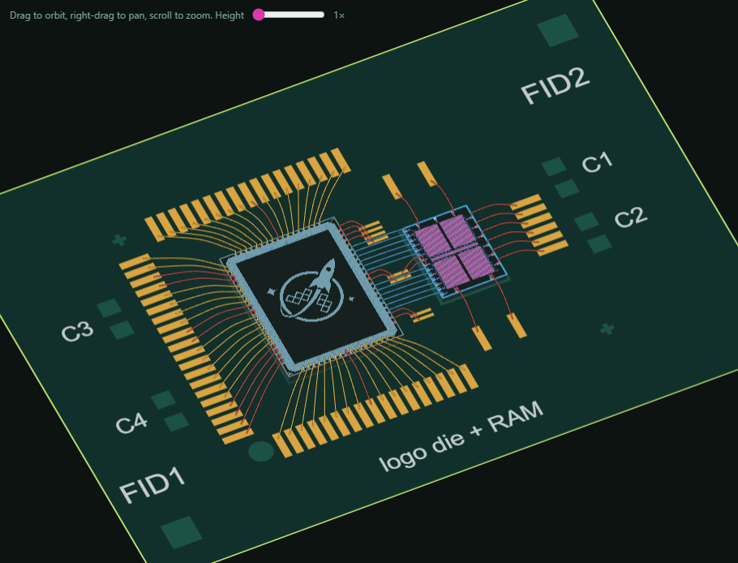

# Two die: the logo die beside a RAM die

The wafer.space logo die and a RAM die side by side on one board. Twelve wires go straight across from one die to the other, and the RAM has its own lands to the board for power. It shows what a board with several die looks like, and what wirebond.svg and the Wire Bond Bench can and can't say about one yet.



To see it, open the Wire Bond Bench (`app/index.html`) and choose **wafer.space die beside a RAM die** under Examples. Or open [`two_die.wb.svg`](two_die.wb.svg) in a browser and hover any wire, pad or land.

**What's made up:** the RAM die, its pin order, the board, the wire types and the die thicknesses. The logo die and the padring lands it keeps are the real ones from [`../waferspace`](../waferspace). Nothing here has been bonded.

## The parts

| | |
|---|---|
| D1, the logo die | 3.93 × 5.12 mm, 74 pads, 280 µm thick, where the 1x1 padring puts it |
| D2, the RAM die | 2.2 × 3.0 mm, 25 pads of 70 µm, 200 µm thick, 1.75 mm to the right of D1. A 64 Mbit pseudo-static RAM with a HyperRAM-like bus: eight data lines DQ0 to DQ7, a strobe RWDS, a clock CK, a chip select CS_N and a reset RESET_N. Four memory banks either side of a control strip, drawn in the wafer.space layers so the bench reads it like any other GDS |
| The board | 22 × 16 × 0.8 mm. One bond ring footprint, J1, holds every land for both die and a VSS paddle under each, like the wafer.space padring does for one. Also two global fiducials for pick and place, and four 100 nF decoupling capacitors just outside the glob top. No tracks |

## Where every wire goes

| From | To | Wires | Type |
|---|---|---|---|
| D1's bottom, top and left sides | The padring's lands, pad n to land n | 54 | STD20, PWR20 |
| D1's right edge: VDD and VSS pads 18, 19 and 34 to 37 | Short lands in the gap | 6 | PWR20 |
| D1's pads 26 and 27, VDD and VSS, in the middle of its right edge | Lands 26 and 27 in the gap, shared with the RAM | 2 | PWR20 |
| The RAM's VDD and VSS pads facing D1 | The same lands 26 and 27 | 2 | PWR20 |
| D1's bidir pads on its right edge | The RAM's bus pads, straight across | 12 | D2D20 |
| The RAM's other VDD and VSS pads, on its bottom, right and top | Its own lands, 101 to 110 | 10 | PWR20 |
| The RAM's TEST pad | Nothing: a probe pad for wafer test | 0 | |

86 wires in all. The bus, from the bottom of D1's right edge up:

| D1 pad | D1 net | RAM pin |
|---|---|---|
| 20 to 23 | bidir_PAD[14] to [17] | DQ0 to DQ3 |
| 24 | bidir_PAD[18] | RWDS |
| 25 | bidir_PAD[19] | CK |
| 26, 27 | VDD, VSS | VDD, VSS, through the shared lands |
| 28 | bidir_PAD[20] | CS_N |
| 29 | bidir_PAD[21] | RESET_N |
| 30 to 33 | bidir_PAD[22] to [25] | DQ4 to DQ7 |

## Why it's laid out this way

**The pads face each other at the same pitch.** The RAM's left-edge pads sit at the same heights as D1's right-edge pads, 211 µm apart, so every die-to-die wire runs straight and parallel, and none cross. A real RAM die is bought, and its pads can't move. So in practice you place your own die's bus pads to match the RAM's pin order and pitch. Here the RAM was invented to match D1.

**The gap is set by the lands in it.** The bench's die-edge-to-land rule, from Samtec's die attach guide, asks for 375 µm or twice the die's thickness, whichever is more, because die attach epoxy bleeds out from under the die. That's 560 µm from the 280 µm logo die and 400 µm from the 200 µm RAM. The gap lands are 700 µm long, 600 µm from D1 and 450 µm from the RAM, so the gap is 1.75 mm. The die-to-die wires then span 1.87 mm, which is 93 wire diameters, just under the 100-diameter rule of thumb for wire sag and sweep. With no lands in the gap, the die could sit much closer: Europractice's minimum is 250 µm.

**Power never runs through the other die.** D1 has a VDD and VSS pair in the middle of its right edge, between the bus pads. Each goes to a short land in the gap, and the RAM's own VDD and VSS pads opposite them go to the same lands, one wire from each side, with the two stitches 0.3 mm apart. Every supply pad reaches board copper. On a real board those two lands are boxed in by bus wires, so each would need a via down to an inner plane. D1's other supply pads on that edge sit above and below the RAM and go to their own gap lands.

**The bus wires are ball on D1, stitch on the RAM.** D1 is the higher die, its top at 305 µm against the RAM's 225 µm, so the wire steps down to its stitch as a wire to the board does. A stitch pressed straight onto a die pad can crack the layers under it, so bonders first put a stud bump on each RAM pad, a ball with its wire broken off, and stitch onto that bump. This is called bond stitch on ball (BSOB). The bond order reflects it: the die-to-die wires are bonded last.

**Their loop drops late.** D2D20 rises 150 µm, eases down 60 µm over most of the span, then falls steeply over the last tenth. The RAM's pads are only 60 µm from its edge, and the wire must clear that edge by 40 µm. A loop that came down gradually, like STD20's, would graze it.

**The RAM is thinner.** Memory die are often thinned, and it shows in the section view: two die tops at different heights, with the bus wires stepping down 80 µm.

## What the format and tools can't say yet

- **Nets across two die.** Each die names its pads for itself, so the bench's net check warns on all twelve bus wires: `bidir_PAD[14]` at one end and `DQ0` at the other. The wire's `wb:net` takes the far pad's name, `DQ0`. Neither is the board's net name, such as `RAM_DQ0`, and there's no land to carry one. The format needs a way to give a die-to-die wire its own net and check both pads against it.
- **The stud bumps.** Nothing in the file says the RAM's pads get a bump before their stitch. SPEC.md lists `security-bump` as proposed. This example is a case for it.
- **`drc.py` reads one die.** `drc.py check` can't check this file. It takes the first die and treats every pad as that die's. The bench's own checks cover both die and both ends of every wire.
- **Design rules don't travel in the .wb.svg.** The bench rebuilds a board from the file, but its copper has no nets, and KiCad's default 0.2 mm clearance applies unless you add `two_die.kicad_pro`. For a board to build, assemble from `two_die.kicad_pcb`, as `make_two_die.py` does.

The bench's checks on it: nothing fails. Three things aren't a pass: the twelve net warnings above, D1's 44 long fan-out wires over the 100-diameter rule of thumb (the main example has the same), and the RAM's TEST pad, unbonded on purpose. KiCad's DRC of the assembled board finds nothing but the unrouted nets.

## Files

| File | What it is |
|---|---|
| `make_two_die.py` | Builds everything. The layout's numbers and the wire plan are at its top |
| `psram_die.gds` | The RAM die: outline on 0/0, pads on 37/0, pin names on 81/10, and Metal1 to Metal5 |
| `two_die.kicad_pcb`, `.kicad_pro` | The board as a PCB designer would draw it, before any die or wire. 0.1 mm clearance, as on the wafer.space boards |
| `two_die.wb.svg` | The assembled bond diagram, as the bench writes it: both die with their artwork, every wire, the stack and the board |
| `two_die_3d.png` | The bench's 3D view of it |

## Rebuilding

```sh
pip install gdstk lxml ezdxf playwright
python examples/two_die/make_two_die.py
python app/make_samples.py
```

`make_two_die.py` writes the RAM die and the board, then has the bench put them together in a headless Chrome, since the bench is the only writer that handles several die. It loads the board and both GDS files, puts each die where the plan says, makes every wire, and writes `two_die.wb.svg`. `--inputs` writes only the RAM die and the board. The output is the same byte for byte each time. `tests/test_app.py` runs the same assembly and checks that it still gives this file, and that KiCad passes the assembled board.

The bench's **Put it in KiCad** writes the assembled board with a 3D model of every wire, about 5 MB, so it isn't kept here.

---

<sub> Part of [wirebond.svg](https://github.com/anfroholic/wirebond.svg), a viewable wire bond exchange format, and its browser app Wire Bond Bench. (c) Andrew Wingate, MIT licence.</sub>
