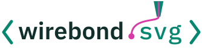

<p align="center">
  <a href="https://github.com/anfroholic/wirebond.svg">
    <picture>
      <source media="(prefers-color-scheme: dark)" srcset="../app/brand/wirebond-logo.svg">
      
    </picture>
  </a>
</p>

# wbsvg: Python for .wb.svg files

A [wirebond.svg](https://github.com/anfroholic/wirebond.svg) file (`.wb.svg`) is a wire bond diagram you can open in any browser. It is also data. Every pad, land, wire, loop profile and layer is a drawn SVG element, and its values sit on it as `wb:` key/value attributes:

```xml
<line x1="5060" y1="9003" x2="3300" y2="11000" stroke-width="20"
      wb:kind="wire" wb:name="W01" wb:from="U1.1" wb:to="L1" wb:profile="STD20" wb:seq="1" wb:net="clk_PAD"/>
```

The tools here read that data back out: the bond list, the nets, the loop profiles and wire lengths, and design rule checks.

| Script | What it does | Needs |
|---|---|---|
| [wbsvg.py](https://github.com/anfroholic/wirebond.svg/blob/main/tools/wbsvg.py) | The library: reads any `.wb.svg` into Python objects you can query, and writes tables: `info`, `bondlist`, `table`, `query`, `json`, `check`, `place`, `export` | nothing to read; `lxml` for `check`, `place`, `export` |
| [drc.py](https://github.com/anfroholic/wirebond.svg/blob/main/tools/drc.py) | The design rule checker and reference writer that `wbsvg.py` uses: `check`, `place`, `export` | `lxml`; `ezdxf` for `export` |

Wire Bond Bench doesn't run these. It has its own checks, in JavaScript, and reads and writes the same files.

## Install

```sh
pip install wbsvg               # the wbsvg command, and import wbsvg
pip install "wbsvg[dxf]"        # also ezdxf, for wbsvg export's 3D DXF
```

Or don't install anything. Each script is one file: copy it out and run it. `wbsvg.py` needs `drc.py` beside it only for `check`, `place` and `export`. With [uv](https://docs.astral.sh/uv/), `uv run tools/wbsvg.py info board.wb.svg` fetches what the script's header lists.

## From the shell

```sh
wbsvg info board.wb.svg                          # what's in it: dies, wires, wire used, stack, fiducials, rules
wbsvg bondlist board.wb.svg -o bonds.csv         # one row per wire, in bond order, for a bonder
wbsvg bondlist board.wb.svg --origin board --units mm
wbsvg table board.wb.svg profiles                # also: wires pads lands nets dies layers fiducials parts
wbsvg query board.wb.svg wire "net=VSS|VDD"      # elements whose wb: attributes match, one JSON per line
wbsvg json board.wb.svg > board.json             # everything read, as JSON
wbsvg check board.wb.svg                         # exits 1 on an error

wbsvg place board.wb.svg                         # how far the die can move or turn before a check fails
wbsvg export board.wb.svg out                    # out.bondlist.csv, out.fiducials.csv, out.dxf
```

Without installing, run the same commands as `python tools/wbsvg.py ...` and `python tools/drc.py ...`.

## From Python

```python
import re, wbsvg

a = wbsvg.load("board.wb.svg")
print(a.summary())

for w in a.wires:                                  # in bond order
    print(w.seq, w.name, w.from_, "->", w.to, w.profile, w.length, w.loop_height)   # um; None if it can't be known

a.wire("W01").loop3d()                             # the loop's control points on the board, (x, y, z)
a.pad("U1.12").net                                 # pads are named <die>.<pad>, as wires name them
a.net("VSS")                                       # Net(name, pads, lands, wires)
a.die("U1").to_board(496, 28)                      # a GDS point on the die, on the board
a.unbonded_pads(), a.unused_lands()
a.wire_usage()                                     # wire used, by material and diameter, in um

a.query("wire", net="VSS")                         # match any wb: attribute, as the file spells it
a.query("wire", to_kind="die")                     # wb:to-kind: write - as _
a.query("wire", profile=["PWR20", "GND20"])        # any of these
a.query("pad", die="D2", net=re.compile(r"DQ\d"))  # or a regex, or the object's own fields
a.query("wire", length=lambda v: v > 3000)         # or a function

a.bondlist()                                       # rows: die-centred, y up, z up, um, as wbsvg export writes
a.bondlist(origin="board", units="mm")             # from the board's lower-left corner instead
a.table("profiles")                                # per profile: wires using it, spans, loop heights, total length

r = a.check()                                      # Report: errors, warnings, notes, metrics
r.ok, r.errors
a.seal                                             # "intact", "drawing changed", "data changed" or "none"

a.to_json()                                        # everything, as JSON
```

Every table is a list of flat dicts, so it goes straight into `csv.DictWriter` or pandas: `pandas.DataFrame(a.table("wires"))`.

### What it reads

| On `Assembly` | Holds |
|---|---|
| `design`, `rev`, `version`, `rules` | The root attributes; `rules` as `wire_gap`, `edge_clear`, `fid_clear` in µm |
| `board` | The board outline: `x`, `y`, `w`, `h` |
| `dies` | Each `Die`: `name`, `gds_cell`, size `w`, `h`, placement `x`, `y`, `rotation`, centre `cx`, `cy`, its `pads`, and `z_bottom`, `thickness`, `z_top`, `attach` from the section view |
| `pads` | Every die's `Pad`s: `die`, `name`, `ref` (`U1.12`), `net`, `x`, `y`, `w`, `h` in the die's own frame, and `cx`, `cy` on the board |
| `lands` | `Land`s: `name`, `net`, `finish`, as drawn, and `cx`, `cy`, `rotation` on the board |
| `wires` | `Wire`s in bond order: `name`, `seq`, `tier`, `net`, `from_`, `to`, `to_kind` (`land` or `die`), `profile`, `diameter`, bond points `x1`, `y1`, `z1`, `x2`, `y2`, `z2`, and `span`, `length`, `loop_height`, `loop_top` from the profile |
| `profiles` | `Profile`s: `name`, `material`, `diameter`, `style`, `dir`, `moves`, `interp`, `ref_span`, `choice`; `steps(span)` gives the moves in µm |
| `stack` | The section view's `Layer`s: `name`, `role`, `material`, `z`, `thickness`, `top` |
| `fiducials`, `parts`, `tolerances` | Fiducials in either frame with their reference points, parts from the board view, and die placement tolerances |
| `items` | Every element with a `wb:kind`, as written: `kind`, `name`, `tag`, `attrs`, `title` |

Every object also has `attrs`, its `wb:` attributes exactly as written, and `title`, its hover text. So an attribute this version doesn't know is still there: `w.get("security-bump")`.

### Was it edited?

Every file `drc.py` or Wire Bond Bench writes is sealed: two SHA-256 digests on the root, `wb:data-sha256` over the data and `wb:drawing-sha256` over everything drawn ([SPEC.md, Seal](https://github.com/anfroholic/wirebond.svg/blob/main/SPEC.md#seal-draft)). Both `check`s compare them with the file. If the data has changed since it was written, by hand or in Inkscape, that's an error. If only the drawing has changed, such as a label, hover text or a colour, that's a warning. If there's no seal, there's a note. Opening and saving in Inkscape without a change keeps the seal.

To seal a file you wrote some other way, use `drc.seal("board.wb.svg")`. It adds the two attributes to the root tag and leaves everything else as it was. The seal catches edits made in good faith, not deliberate ones: anyone can reseal a file.

Lengths are µm. Board coordinates are the file's: x right, y down, from the board's top-left corner. Pad coordinates are the die's own, as in its GDS, with y up. z is up from the top of the board.

`wbsvg.py` reads several dies, a turned die and die-to-die wires, as Wire Bond Bench writes them. `drc.py` reads one die, not turned. So `check()` runs the consistency checks on any file, and runs `drc.py`'s design rules too when `drc.py` can read the file. Its notes say which.

## Adding a script

So that each script stays usable on its own:

- **One file**, run as `python tools/<name>.py`. It takes files as arguments and never reaches into the rest of the repo.
- **Its dependencies go in a header** at the top, the [inline script metadata](https://packaging.python.org/en/latest/specifications/inline-script-metadata/) that `uv run` and `pipx run` read. Copy the one at the top of `drc.py`.
- **It imports only** the standard library, what its header lists, and `drc.py` from this folder. A script that imports `drc` lists `lxml` in its own header too.
- **`main(argv)` returns the exit code**, and `if __name__ == "__main__": sys.exit(main())` calls it. That way a script, a test or another tool can run it without starting a new process.
- **Say in its docstring** what it does and how to run it, and add it to the table above.
- **To ship it in the package**, copy it into [python/src/wbsvg/](https://github.com/anfroholic/wirebond.svg/tree/main/python/src/wbsvg) as a module of the wbsvg package.

## The wbsvg package

These two scripts are the [wbsvg package](https://github.com/anfroholic/wirebond.svg/tree/main/python) on PyPI, as single files: `wbsvg.py` is `python/src/wbsvg/__init__.py` and `drc.py` is `python/src/wbsvg/drc.py`, byte for byte. `tests/test_py.py` checks they stay the same, so change one and copy it to the other. The package is built and released from [python/](https://github.com/anfroholic/wirebond.svg/tree/main/python); its README says how.

---

<sub> Part of [wirebond.svg](https://github.com/anfroholic/wirebond.svg), a viewable wire bond exchange format, and its browser app Wire Bond Bench. (c) Andrew Wingate, MIT licence.</sub>
